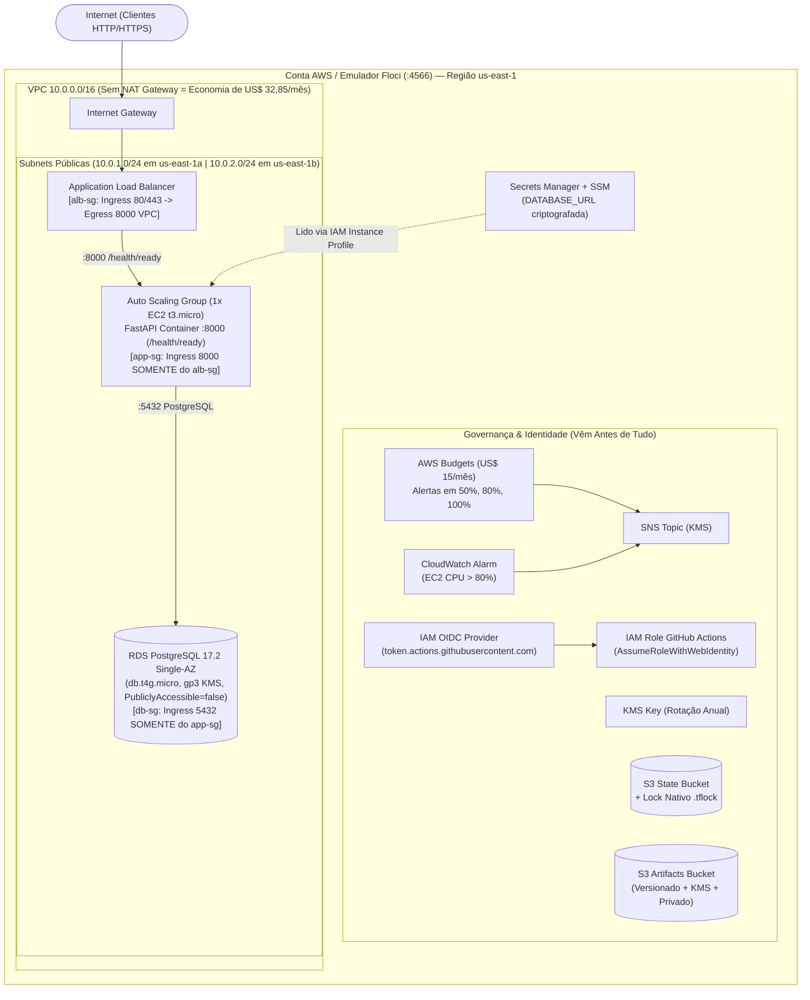
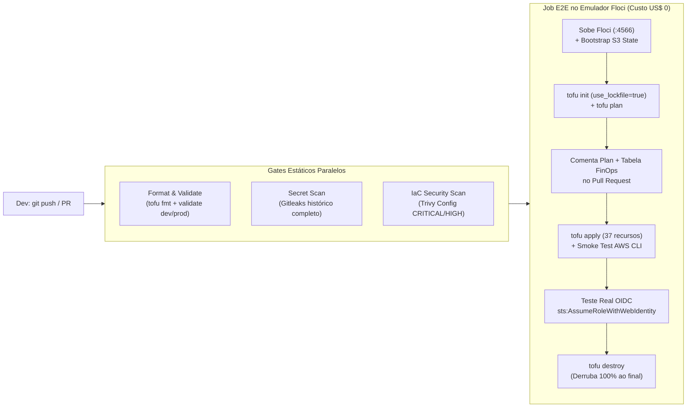

# Infraestrutura AWS Econômica com OpenTofu & Floci (CI/CD + OIDC + FinOps)

[](https://github.com/Gabriel-V-Mendes/infraestrutura-aws-terraform-localstack/actions/workflows/infra-ci.yml)

Infraestrutura na AWS declarada em **OpenTofu (1.10+)** com arquitetura enxuta voltada a **FinOps**, **Zero Chaves Estáticas (GitHub Actions OIDC)**, **State em S3 com Lock Nativo (`use_lockfile = true`)**, validação DevSecOps com **Trivy Config / Checkov** e emulação local 100% open-source via **[Floci (`floci-io/floci`)](https://github.com/floci-io/floci)**.

---

## 1. Problema

A primeira versão deste repositório (`commit dd249e2`) tentava demonstrar uma arquitetura 3-Tier com Terraform e LocalStack, mas apresentava problemas estruturais de custo, segurança e automação:

| Sintoma na versão antiga (`dd249e2`) | Consequência prática |
|---|---|
| Os arquivos foram commitados dentro de `Documentos/Infraestrutura_aws_terraform/` e `.github/workflows/terraform.yml` tinha **0 bytes** | O pipeline do GitHub Actions **nunca executava** |
| `variables.tf` e `outputs.tf` da raiz estavam com **0 bytes** | A infraestrutura não expunha endpoints nem aceitava parametrização por ambiente |
| `modules/networking` provisionava **NAT Gateway (`aws_nat_gateway`) + Elastic IP** | Custo fixo de **~US$ 32,85/mês** (+ tráfego por GB) na AWS real mesmo com zero requisições |
| `modules/database` criava uma `aws_instance.postgres_mock` (EC2 comum) em vez de `aws_db_instance` | Não provisionava RDS real porque o LocalStack Community bloqueava recursos avançados |
| `provider.tf` e `backend.tf` tinham `access_key = "test"` e `secret_key = "test"` chumbados no código | Hábito inseguro de credenciais estáticas no HCL; sem federação OIDC |
| `backend-setup/main.tf` criava tabela **DynamoDB** para state lock mesmo usando `use_lockfile = true` | Recurso redundante: o OpenTofu/Terraform 1.10+ faz lock nativo direto no S3 via `.tflock` |
| Instâncias sem IMDSv2 (`http_tokens = "required"`), EBS sem criptografia e SGs com egress `0.0.0.0/0` irrestrito | **21 falhas** no `trivy config` (2 CRITICAL, 11 HIGH) |
| Não havia orçamento (`aws_budgets_budget`), alertas SNS/CloudWatch, ALB nem Auto Scaling | Desenho incompleto e sem governança financeira (FinOps) |
| Dependência do `localstack/localstack:4.13.1` | O LocalStack Community foi descontinuado/congelado em março de 2026 |

**Objetivo:** reestruturar o projeto de ponta a ponta com **OpenTofu** e **Floci**, aplicando o desenho econômico atualizado (sem NAT Gateway e sem RDS Multi-AZ por padrão), orçamento/alertas antes de tudo, autenticação sem chaves estáticas via **OIDC**, state em S3 com lock nativo e ciclo completo (`init` → `plan` → `apply` → `smoke` → `destroy`) validado automaticamente a cada Pull Request.

**Critérios de pronto:**
- [x] `destroy` e `apply` do zero funcionam com um único comando (`make test`) e rodam a cada push/PR no GitHub Actions.
- [x] O resultado do `tofu plan` + tabela FinOps aparecem comentados automaticamente no Pull Request.
- [x] Não existe nenhuma chave de acesso estática no código ou histórico (`gitleaks` verde + federação OIDC com `sts:AssumeRoleWithWebIdentity`).
- [x] O custo por hora e por mês na AWS real está documentado em detalhes (ver [§7](#7-finops-custo-por-hora-e-por-mês-aws-real-vs-floci)) e toda a infraestrutura é derrubada ao final (`Destroy complete! Resources: 37 destroyed`).

---

## 2. Arquitetura

### 2.1 Topologia Econômica na AWS / Floci (Sem NAT Gateway, SGs Estritos em 3 Camadas)



### 2.2 Pipeline CI/CD & DevSecOps (`.github/workflows/infra-ci.yml`)



### 2.3 Estrutura Modular do Repositório

```text
.
├── docker-compose.yml               # Emulador AWS Floci (floci/floci:2.3.0 fixado por digest SHA256)
├── Makefile                         # Atalhos: make up, test, plan, apply, smoke, oidc, destroy, scan
├── modules/                         # Módulos reutilizáveis e agnósticos de ambiente
│   ├── budget-alerts/               # 1. Orçamento (AWS Budgets), SNS criptografado e CloudWatch Alarm
│   ├── iam-oidc/                    # 2. OIDC Provider do GitHub Actions + Role sem chaves + EC2 Profile
│   ├── storage/                     # 3. KMS Key + Bucket S3 versionado, criptografado e privado
│   ├── network/                     # 4. VPC, IGW, 2 Subnets Públicas (sem NAT) e 3 Security Groups estritos
│   ├── database/                    # 5. RDS PostgreSQL 17.2 Single-AZ + Secrets Manager + SSM Parameter
│   └── compute/                     # 6. ALB (/health/ready), Target Group, Launch Template (IMDSv2) e ASG (1x EC2)
├── environments/                    # Separação por diretórios de ambiente
│   ├── floci-local/                 # Ambiente local e CI apontando para Floci (http://localhost:4566)
│   └── aws-prod/                    # Ambiente AWS Real autenticado via OIDC (sem override de endpoints)
├── scripts/
│   ├── bootstrap-state.sh           # Inicializa o bucket S3 de state versionado
│   ├── smoke-infra.sh               # Verifica os 37 recursos provisionados via AWS CLI
│   ├── verify-oidc.sh               # Valida sts:AssumeRoleWithWebIdentity emitindo SessionToken temporário
│   ├── lifecycle-test.sh            # Orquestra init -> validate -> plan -> apply -> smoke -> OIDC -> destroy
│   └── protect-main.sh              # Ativa branch protection exigindo os 4 checks verdes na main
└── .github/workflows/infra-ci.yml   # Pipeline declarativo completo com PR Plan Comment
```

### 2.4 Inventário dos 37 Recursos Provisionados (6 Módulos)

| Módulo | Qtd | Recursos Gerenciados (`tofu state list`) | Função Principal |
|---|:---:|---|---|
| [`modules/budget-alerts`](modules/budget-alerts/main.tf) | **4** | `aws_budgets_budget.monthly_cost`, `aws_sns_topic.alerts`, `aws_sns_topic_subscription.email[0]`, `aws_cloudwatch_metric_alarm.cpu_high` | Orçamento mensal (US$ 15) com alertas em 50%/80%/100% (atual e previsto) e alarme de CPU > 80% |
| [`modules/iam-oidc`](modules/iam-oidc/main.tf) | **6** | `aws_iam_openid_connect_provider.github_actions`, `aws_iam_role.github_actions_oidc`, `aws_iam_role_policy.github_actions_iac`, `aws_iam_role.ec2_app`, `aws_iam_role_policy.ec2_app_least_privilege`, `aws_iam_instance_profile.ec2_app` | Federação OIDC (`token.actions.githubusercontent.com`) sem chaves estáticas e perfil de instância EC2 com menor privilégio |
| [`modules/storage`](modules/storage/main.tf) | **7** | `aws_kms_key.main`, `aws_kms_alias.main`, `aws_s3_bucket.artifacts`, `aws_s3_bucket_versioning.artifacts`, `aws_s3_bucket_server_side_encryption_configuration.artifacts`, `aws_s3_bucket_public_access_block.artifacts`, `aws_s3_bucket_lifecycle_configuration.artifacts` | Chave KMS com rotação anual + Bucket S3 versionado, criptografado (`aws:kms`), 100% privado e com regra de lifecycle |
| [`modules/network`](modules/network/main.tf) | **10** | `aws_vpc.main`, `aws_internet_gateway.main`, `aws_subnet.public[0..1]`, `aws_route_table.public`, `aws_route_table_association.public[0..1]`, `aws_security_group.alb`, `aws_security_group.app`, `aws_security_group.db` | VPC (`10.20.0.0/16` no Floci / `10.0.0.0/16` em Prod), 2 Subnets Públicas Multi-AZ (**0 NAT Gateways**) e 3 Security Groups encadeados |
| [`modules/database`](modules/database/main.tf) | **5** | `aws_db_subnet_group.main`, `aws_db_instance.postgres`, `aws_secretsmanager_secret.database_url`, `aws_secretsmanager_secret_version.database_url`, `aws_ssm_parameter.db_endpoint` | RDS PostgreSQL Single-AZ (`db.t4g.micro`, `gp3` KMS, `publicly_accessible = false`) + `DATABASE_URL` no Secrets Manager |
| [`modules/compute`](modules/compute/main.tf) | **5** | `aws_lb.app`, `aws_lb_target_group.app`, `aws_lb_listener.http`, `aws_launch_template.app`, `aws_autoscaling_group.app` | Application Load Balancer, Target Group (`/health/ready`), Launch Template (`t3.micro`, IMDSv2 obrigatório, EBS KMS) e ASG (1 instância) |
| **Total** | **37** | **0 chaves estáticas · 0 NAT Gateways · 0 tabelas DynamoDB** | **Stack completa reproduzível do zero** |

---

## 3. Subir e testar tudo com um comando

Pré-requisitos: Docker (com Compose v2), OpenTofu (`>= 1.10`), AWS CLI v2, `jq`, `trivy` e `gitleaks`.

```bash
make test     # Sobe o Floci e executa: bootstrap S3 -> init -> validate -> plan -> apply -> smoke -> OIDC -> destroy
```

Se quiser inspecionar os recursos ativos antes de destruir:

```bash
make up       # Sobe o Floci em background (~3s) na porta 127.0.0.1:4566
make apply    # Inicializa o backend S3 com lock nativo e provisiona os 37 recursos
make smoke    # Executa 7 baterias de verificação via AWS CLI contra o Floci
make oidc     # Testa a federação OIDC (sts:AssumeRoleWithWebIdentity) sem chaves estáticas
make destroy  # Derruba todos os 37 recursos ao final
make down     # Desliga o container do Floci e remove o volume temporário
```

### 3.1 Resultado Real da Suíte de Validação (`make scan secrets test down`)

Saída verificada localmente e no GitHub Actions:

```text
1. make scan (trivy config --severity CRITICAL,HIGH --exit-code 1 .)
   ├── environments/aws-prod    : 0 misconfigurations
   ├── environments/floci-local : 0 misconfigurations
   ├── modules/compute/main.tf  : 0 misconfigurations
   ├── modules/database/main.tf : 0 misconfigurations
   ├── modules/network/main.tf  : 0 misconfigurations
   └── modules/storage/main.tf  : 0 misconfigurations

2. make secrets (gitleaks git & dir)
   └── commits & working tree scanned -> no leaks found (0 chaves estáticas)

3. make test (scripts/lifecycle-test.sh contra floci/floci:2.3.0)
   ├── [Bootstrap] Bucket 'devops-api-tofu-state' pronto para state + lock nativo (.tflock)
   ├── [OpenTofu]  Backend S3 inicializado (use_lockfile = true) + Config validada
   ├── [Apply]     Apply complete! Resources: 37 added, 0 changed, 0 destroyed.
   ├── [Smoke 1/7] State remoto gravado em s3://devops-api-tofu-state/floci-local/terraform.tfstate
   ├── [Smoke 2/7] Bucket S3 'devops-api-floci-artifacts' com Versioning=Enabled e SSE-KMS
   ├── [Smoke 3/7] FinOps: Orçamento mensal ativo (US$ 15.0) + SNS Topic + CloudWatch Alarm
   ├── [Smoke 4/7] IAM OIDC Provider (token.actions.githubusercontent.com) + Roles criadas
   ├── [Smoke 5/7] VPC (10.20.0.0/16), 2 Subnets Públicas, 0 NAT Gateways e 3 SGs estritos
   ├── [Smoke 6/7] RDS PostgreSQL Single-AZ (MultiAZ=False) + Secrets Manager DATABASE_URL
   ├── [Smoke 7/7] ALB (active) + Target Group (/health/ready) + ASG (DesiredCapacity=1)
   ├── [OIDC]      sts:AssumeRoleWithWebIdentity -> AssumedRoleUser + Temporary AccessKeyId (ASIAR8W3***)
   └── [Destroy]   Destroy complete! Resources: 37 destroyed.
```

> [!TIP]
> **Endpoint & Healthcheck da Floci:** Com o emulador rodando (`make up`), consulte o status em `http://localhost:4566/_floci/health` ou inspecione qualquer recurso via `aws --endpoint-url http://localhost:4566 ...`.

---

## 4. O que mudou nesta reformulação (2026)

### 4.1 Por que Floci (`floci-io/floci`) no lugar do Free Tier da AWS e do LocalStack?
1. **Fim do Free Tier antigo e do LocalStack Community:** Contas AWS antigas não têm direito ao novo programa de créditos, e o LocalStack Community foi descontinuado em março de 2026 (passando a exigir token e bloqueando RDS, ALB e ASG).
2. **Floci é 100% Open-Source (MIT), leve e sem travas:** Construído em Quarkus + GraalVM nativo (~13 MiB de RAM em repouso e ~24 ms de boot), o Floci emula **S3, IAM, STS (incluindo OIDC), VPC, EC2, Auto Scaling, ELBv2 (ALB), RDS PostgreSQL, KMS, Secrets Manager, SSM, CloudWatch e AWS Budgets** na porta `4566` sem conta e sem token.

### 4.2 State em S3 com Lock Nativo (`use_lockfile = true`, sem DynamoDB)
A partir do OpenTofu 1.10 / Terraform 1.10, o backend `s3` suporta **S3 Native State Locking** por meio do atributo `use_lockfile = true` em [`environments/floci-local/backend.hcl`](environments/floci-local/backend.hcl) e [`environments/aws-prod/backend.hcl.example`](environments/aws-prod/backend.hcl.example):
- O OpenTofu cria um arquivo `.tflock` diretamente no bucket S3 usando cabeçalhos de escrita condicional (`If-None-Match: *`).
- **Resultado:** A tabela `aws_dynamodb_table.terraform_locks` que existia na versão antiga foi **100% eliminada**, reduzindo complexidade e superfície de manutenção.

### 4.3 Autenticação OIDC sem Chaves Estáticas
- **Zero chaves no código:** Nenhum arquivo `.tf` ou `.hcl` contém `access_key` ou `secret_key`.
- **Provedor e Role provisionados via IaC:** O módulo [`modules/iam-oidc`](modules/iam-oidc/main.tf) cria o `aws_iam_openid_connect_provider` para `https://token.actions.githubusercontent.com` e a `aws_iam_role` com *Trust Policy* restrita exclusivamente a `repo:Gabriel-V-Mendes/infraestrutura-aws-terraform-localstack:*`.
- **Testado de verdade no CI:** O script [`scripts/verify-oidc.sh`](scripts/verify-oidc.sh) executa `aws sts assume-role-with-web-identity` contra o STS da Floci passando um JWT OIDC e valida a emissão de `AccessKeyId` (`ASIA...`) + `SessionToken` temporários.

### 4.4 Segurança Estática (Trivy Config & Gitleaks) e Ajustes Técnicos
```bash
make scan     # trivy config --severity CRITICAL,HIGH --exit-code 1 .
make secrets  # gitleaks git & dir
```
- **IMDSv2 obrigatório (`http_tokens = "required"`):** Configurado no `aws_launch_template` para impedir ataques de SSRF ao serviço de metadados da instância.
- **Criptografia KMS (`aws_kms_key`) em repouso:** Habilitada em S3, RDS (`storage_encrypted = true`), EBS, SNS, Secrets Manager e SSM Parameter Store.
- **Política IAM S3 de menor privilégio (correção `AWS-0345`):** As permissões S3 da Role do GitHub Actions em [`modules/iam-oidc/main.tf`](modules/iam-oidc/main.tf) são restritas apenas aos buckets do projeto (`arn:aws:s3:::${var.project_name}-*`), sem curingas `s3:*` globais.
- **Resolução dinâmica de `account_id` no AWS Budgets:** O módulo [`modules/budget-alerts/main.tf`](modules/budget-alerts/main.tf) obtém o ID da conta via `data.aws_caller_identity.current.account_id` (`000000000000` na Floci), garantindo compatibilidade mesmo quando `skip_requesting_account_id = true`.
- **Execução determinística de Control-Plane no CI:** O [`docker-compose.yml`](docker-compose.yml) configura `FLOCI_SERVICES_EC2_MOCK=true`, `FLOCI_SERVICES_EC2_MOCK_PUBLIC_ADDRESSES=fixed`, `FLOCI_SERVICES_EC2_VPC_NETWORKS_ENABLED=false` e `FLOCI_SERVICES_RDS_MOCK=true`, permitindo testar todo o ciclo de vida em runners não privilegiados do GitHub Actions em poucos segundos.

---

## 5. CI/CD, Comentário do `plan` no PR e Proteção de Branch

Arquivo: [`.github/workflows/infra-ci.yml`](.github/workflows/infra-ci.yml)

| Job | Quando roda | O que faz | Falha se |
|---|---|---|---|
| **Format & Validate (OpenTofu)** | PR e push | `tofu fmt -check -recursive` + `tofu validate` em `floci-local` e `aws-prod` | Código fora do padrão ou erro de validação |
| **Secret Scan (Gitleaks)** | PR e push | `gitleaks` em todo o histórico (`fetch-depth: 0`) | Qualquer chave estática ou segredo for detectado |
| **IaC Security Scan (Trivy Config)** | PR e push | `trivy config` varrendo todos os módulos e ambientes | Houver qualquer misconfiguration `CRITICAL` ou `HIGH` |
| **E2E Apply, OIDC & Destroy (Floci)** | Após os 3 acima | Sobe o Floci → Bootstrap S3 → `tofu init` → `tofu plan` → **Comenta o Plan + Tabela FinOps no PR** → `tofu apply` (37 recursos) → `smoke-infra.sh` → `verify-oidc.sh` → `tofu destroy` | Qualquer etapa do ciclo de vida ou smoke test falhar |
| **Deploy AWS Prod (OIDC)** | Push na `main` se `AWS_PROD_ENABLED=true` | Assume a IAM Role na AWS real via OIDC (`id-token: write`) e executa o OpenTofu | Falha de federação OIDC ou plano inválido |

### 5.1 Proteção da Branch `main` e Comentário Automático no PR

A branch `main` é protegida via [`scripts/protect-main.sh`](scripts/protect-main.sh) (`make protect-main`), exigindo Pull Request atualizado, histórico linear e os **4 status checks obrigatórios** verdes antes de liberar o merge (inclusive para administradores).

Para testar o comentário automático do `tofu plan` + tabela FinOps em um Pull Request:

```bash
git switch -c feat/ajuste-tag-orcamento
# Faça um pequeno ajuste em environments/floci-local/variables.tf
git commit -am "feat: ajusta limite de alerta do orçamento"
git push -u origin feat/ajuste-tag-orcamento
gh pr create --fill
```

Assim que o job **E2E Apply, OIDC & Destroy (Floci)** executar no PR, o bot `github-actions[bot]` publicará (ou atualizará) um comentário no próprio PR contendo a tabela de custos por hora/mês e a saída completa do `tofu plan`.

---

## 6. Antes × Depois

Medições realizadas na mesma máquina (Linux x86_64, Docker 29.9, OpenTofu 1.13, Trivy 0.75). **Antes** = commit `dd249e2`; **Depois** = esta versão.

| Métrica / Critério | Antes (`dd249e2`) | Depois (Reformulado) | Δ / Ganho |
|---|---|---|---|
| **Arquivos na raiz correta do repositório** | ❌ Dentro de `Documentos/...` | ✅ Raiz padronizada (`modules/`, `environments/`) | Pipeline CI/CD funcional |
| **Workflow do GitHub Actions** | ❌ 0 bytes (nunca rodou) | ✅ 5 jobs + comentário automático do `plan` no PR | Automação ponta a ponta |
| **Emulador de Nuvem Local** | LocalStack 4.13 (~1 GB imagem, ~143 MiB RAM idle, descontinuado) | **Floci 2.3.0** (~90 MB imagem, **~13 MiB RAM idle**, boot ~24 ms, MIT) | **−91% RAM ociosa** |
| **Misconfigurations no `trivy config`** | **21 falhas** (2 CRITICAL, 11 HIGH, 2 MEDIUM, 6 LOW) | **0 falhas** (0 CRITICAL, 0 HIGH) | **−100% misconfigurations** |
| **Chaves estáticas no código HCL** | ❌ `access_key = "test"` em 3 arquivos | ✅ **0 chaves estáticas** (OIDC + variáveis efêmeras de sessão) | Elimina anti-pattern de segurança |
| **Lock de State no S3** | Criava tabela DynamoDB redundante | **S3 Lock Nativo (`use_lockfile = true`)** com `.tflock` | Menos 1 serviço para manter |
| **Banco de Dados provisionado** | ❌ `aws_instance` (EC2 vazia fingindo ser banco) | ✅ **`aws_db_instance` RDS PostgreSQL 17.2 Single-AZ** + Secrets Manager | Fidelidade real de arquitetura |
| **Camada de Compute & Rede** | 1 EC2 solta + **NAT Gateway** caro | **ALB (`/health/ready`) + ASG (1x EC2) + 3 SGs estritos**, **sem NAT Gateway** | **−US$ 32,85/mês** fixos |
| **Governança FinOps (Budgets + Alarmes)** | ❌ Inexistente | ✅ `aws_budgets_budget` + SNS KMS + CloudWatch CPU Alarm | Alertas antes de tudo |

---

## 7. FinOps: Custo por Hora e por Mês (AWS Real vs. Floci)

Embora toda a validação deste projeto rode a **custo US$ 0,00 no Floci**, um dos requisitos essenciais de engenharia Cloud/FinOps é saber calcular quanto a arquitetura custa por hora e por mês na AWS real (`us-east-1` - N. Virginia, preços On-Demand em outubro/2026) e quanto as decisões econômicas economizam.

### 7.1 Custo por Hora e por Mês da Arquitetura Econômica (`us-east-1`)

| Componente | Recurso OpenTofu | Especificação Econômica | Custo por Hora (USD) | Custo Mensal 730h (USD) | Custo durante 10h de Testes (USD) | Custo no Floci (Local/CI) |
|---|---|---|---:|---:|---:|---:|
| **Rede (VPC)** | `aws_vpc`, `aws_subnet` (x2), `aws_internet_gateway`, `aws_security_group` (x3) | Subnets públicas + SGs estritos (**Sem NAT Gateway**) | US$ 0,0000 | US$ 0,00 | US$ 0,00 | **US$ 0,00** |
| **Compute (ASG 1x EC2)** | `aws_autoscaling_group` + `aws_launch_template` (`t3.micro` Linux) | 2 vCPU, 1 GiB RAM (`$0.0104/h`) + IPv4 público (`$0.0050/h`) | US$ 0,0154 | US$ 11,24 | US$ 0,15 | **US$ 0,00** |
| **Disco EC2 (EBS)** | `block_device_mappings` (`20 GB gp3` KMS) | US$ 0,08/GB-mês = US$ 1,60/mês | US$ 0,0022 | US$ 1,60 | US$ 0,02 | **US$ 0,00** |
| **Load Balancer (ALB)** | `aws_lb`, `aws_lb_target_group`, `aws_lb_listener` | Base `$0.0225/h` + LCU mínimo `$0.0080/h` + 2 IPv4 públicos (`$0.0100/h`) | US$ 0,0405 | US$ 29,56 | US$ 0,41 | **US$ 0,00** |
| **Banco (RDS Single-AZ)** | `aws_db_instance.postgres` (`db.t4g.micro`, Single-AZ) | Instância `$0.0160/h` + 20 GB gp3 (`$0.115/GB-mês` = `$0.0032/h`) | US$ 0,0192 | US$ 13,98 | US$ 0,19 | **US$ 0,00** |
| **Segurança & Storage** | `aws_kms_key` (1 CMK), `aws_secretsmanager_secret` (1 secret), `aws_s3_bucket` (x2) | KMS `$1.00/mês` + Secret `$0.40/mês` + S3 < 5 GB `$0.12/mês` | US$ 0,0021 | US$ 1,52 | US$ 0,02 | **US$ 0,00** |
| **FinOps & Observabilidade** | `aws_budgets_budget`, `aws_sns_topic`, `aws_cloudwatch_metric_alarm` | 1º Budget grátis, 1 alarme CloudWatch `$0.10/mês` | US$ 0,0001 | US$ 0,10 | US$ 0,00 | **US$ 0,00** |
| **TOTAL (Stack Completa)** | **37 recursos provisionados** | **Arquitetura Econômica Completa** | **US$ 0,0795 / hora** | **US$ 58,00 / mês** | **US$ 0,79 (em 10h)** | **US$ 0,00** |

> [!IMPORTANT]
> **Por que derrubar tudo ao final (`tofu destroy`) faz tanta diferença?**
> Manter a stack ligada apenas durante uma bateria de **10 horas de testes no mês** custa **US$ 0,79** na AWS real (contra **US$ 58,00/mês** se esquecida ligada 24x7). E usando o **Floci**, esse custo cai para **US$ 0,00** com execuções ilimitadas!

### 7.2 Comparativo: Desenho Tradicional Caro vs. Arquitetura Econômica deste Projeto

| Decisão de Arquitetura | Desenho Tradicional ("Padrão Antigo") | Desenho Econômico (Este Projeto) | Economia Mensal (730h) |
|---|---|---|---:|
| **Saída de rede das instâncias** | 2x NAT Gateways (Multi-AZ) + 2x EIP (`$0.045/h` cada + IPv4) | **Zero NAT Gateway** (Subnets públicas + SG bloqueando acesso direto à EC2/RDS) | **−US$ 73,00/mês** |
| **Alta disponibilidade do RDS** | RDS Multi-AZ (`db.t3.small` x2 réplicas + 20 GB) | **RDS Single-AZ** (`db.t4g.micro` Graviton durante os testes) | **−US$ 38,60/mês** |
| **Instância de Aplicação** | 2x EC2 `t3.small` fixas | **Auto Scaling de 1x `t3.micro` / `t4g.micro`** | **−US$ 19,27/mês** |
| **Lock do State do Terraform** | Tabela DynamoDB dedicada + KMS | **S3 Lock Nativo (`use_lockfile = true`)** | Simplificação operacional |
| **Custo Total Mensal (AWS Real)** | **≈ US$ 188,87 / mês** (`US$ 0,2587/h`) | **≈ US$ 58,00 / mês** (`US$ 0,0795/h`) | **Economia de US$ 130,87/mês (−69%)** |

### 7.3 Nota sobre o Novo Plano de Créditos da AWS (2025/2026)
Para quem abre uma **nova conta AWS** no modelo atual de Free Tier baseado em créditos:
- A AWS concede **US$ 100 em créditos no cadastro** + **US$ 100 adicionais** ao completar 5 atividades práticas (totalizando **US$ 200** válidos por até 6 meses no plano gratuito).
- Os créditos cobrem **EC2, RDS, ALB, S3, KMS e Secrets Manager**, o que significa que a nossa stack de **US$ 0,0795/hora** poderia rodar por mais de **2.500 horas** dentro dos créditos — ou indefinidamente a **custo zero** usando o **Floci** localmente e no GitHub Actions.

---

## 8. Decisões e Trade-offs

| Decisão | Alternativa | Por quê / Trade-off |
|---|---|---|
| **OpenTofu 1.10+ com `use_lockfile = true`** | Terraform clássico + DynamoDB | 100% open-source (Linux Foundation) e elimina a necessidade de provisionar e manter uma tabela DynamoDB só para travamento de estado |
| **Emulador local Floci (`floci/floci:2.3.0`)** | AWS Free Tier / LocalStack | Não exige conta AWS nem cartão de crédito, não requer token de autenticação e emula RDS, ALB, ASG, OIDC e Budgets gratuitamente em ~13 MiB de RAM |
| **Subnets públicas sem NAT Gateway + SGs em 3 camadas** | Subnets privadas + NAT Gateway | Economiza ~US$ 32,85/mês por AZ. O isolamento de rede não é perdido porque o `app-sg` só aceita tráfego na porta `8000` vindo do `alb-sg`, e o `db-sg` só aceita tráfego na porta `5432` vindo do `app-sg` (além de `publicly_accessible = false` no RDS) |
| **RDS Single-AZ (`multi_az = false` por padrão)** | RDS Multi-AZ | Corta o custo do banco pela metade nos ambientes de teste/homologação. Para produção crítica, basta alterar `multi_az = true` no `aws-prod` |
| **Autenticação OIDC (`AssumeRoleWithWebIdentity`)** | `AWS_ACCESS_KEY_ID` estática nos Secrets | Credenciais temporárias com rotação automática a cada job do GitHub Actions; elimina risco de vazamento de chaves de longa duração |
| **Diretórios por ambiente (`environments/floci-local` e `aws-prod`)** | Terraform Workspaces | Isolamento explícito de backend e provedores sem risco de dar `apply` no workspace errado por engano |

---

## 9. O que eu faria diferente em produção real de larga escala

1. **VPC Endpoints (`S3` Gateway Endpoint gratuito + Interface Endpoints) ou `fck-nat`:** Em vez de NAT Gateway gerenciado caro, usaria o Gateway Endpoint gratuito para S3 e IPv6 Egress-Only Internet Gateway (gratuito na AWS!) para baixar imagens do GHCR em subnets privadas.
2. **Certificado TLS (ACM) + Redirecionamento HTTP → HTTPS no ALB:** Com um domínio no Route53, adicionaria um listener na porta `443` com certificado gratuito do AWS Certificate Manager (ACM).
3. **State Encryption Nativo do OpenTofu (`encryption {}` block):** Criptografaria o próprio conteúdo do `.tfstate` em trânsito e repouso usando chave KMS antes mesmo de enviá-lo ao S3.
4. **ECS Fargate Spot ou AWS App Runner:** Para cargas variáveis, substituir o ALB + EC2 por Fargate Spot ou App Runner pode reduzir ainda mais o custo base do Load Balancer.
